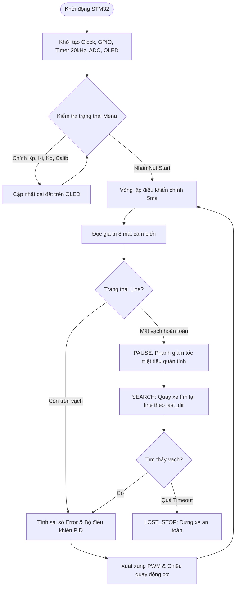

# 🚗 STM32 High-Speed Line Follower Robot (Robot Dò Line STM32)

Dự án xe dò line tốc độ cao sử dụng vi điều khiển **STM32F103C8T6 (ARM Cortex-M3)**, tích hợp thuật toán điều khiển **PID**, hệ thống **8 mắt cảm biến ADC có Auto-Calibration**, và giao diện **Menu trực quan trên màn hình OLED SSD1306**.

---

## 📌 Tính Năng Nổi Bật

- **Giao diện Menu OLED tiện lợi:** Cài đặt thông số Kp, Ki, Kd, Calib cảm biến và test động cơ trực tiếp bằng 3 nút bấm cơ học, không cần cắm máy tính nạp lại code khi tinh chỉnh.
- **Cảm biến 8 mắt ADC độ nhạy cao:** 
  - Hỗ trợ tính toán trọng số tâm line chính xác.
  - Tự động hiệu chuẩn (Auto-Calibrate) ngưỡng trắng/đen phù hợp với mọi điều kiện ánh sáng và chất liệu sân thi đấu.
- **Thuật toán điều khiển PID thời gian thực:** Giúp xe bám vạch mượt mà ở tốc độ cao, hạn chế tối đa hiện tượng rung lắc (wobble).
- **Máy trạng thái (State Machine) chống văng line:**
  - `ROBOT_RUN_NORMAL`: Bám line PID ổn định.
  - `ROBOT_RUN_PAUSE`: Phanh cưỡng bức triệt tiêu quán tính khi bất ngờ mất vạch.
  - `ROBOT_RUN_SEARCH`: Tự động quay tìm lại vạch dựa trên hướng lệch cuối cùng (`last_dir`).
  - `ROBOT_RUN_LOST_STOP`: Dừng xe an toàn nếu vượt quá thời gian tìm kiếm (Timeout).
- **Điều khiển động cơ 20kHz:** Tần số PWM vượt ngưỡng nghe của tai người, giúp động cơ chạy cực êm và phản hồi mượt mà.

---

## 🔌 Sơ Đồ Đấu Nối Phần Cứng (Pinout)

### 1. Vi điều khiển & Màn hình OLED / Nút bấm
| Thiết bị | Chân STM32 | Chức năng | Ghi chú |
| :--- | :--- | :--- | :--- |
| **Nút bấm 1 (UP/NEXT)** | `PB0` | GPIO Input (Pull-up) | Chuyển mục menu / Tăng giá trị |
| **Nút bấm 2 (SELECT/BACK)** | `PB1` | GPIO Input (Pull-up) | Nhấn: Chọn / Giữ 500ms: Quay lại |
| **Nút bấm 3 (START/STOP)** | `PB10` | GPIO Input (Pull-up) | Bắt đầu chạy / Dừng khẩn cấp |
| **Màn hình OLED** | I2C / SPI | Hiển thị giao diện | Menu cài đặt & theo dõi thông số |

### 2. Mạch điều khiển động cơ (Motor Driver TB6612 / L298N)
| Tín hiệu | Chân STM32 | Timer / Kênh | Ghi chú |
| :--- | :--- | :--- | :--- |
| **PWMA (Bánh trái)** | `PB7` | TIM4_CH2 | Tần số 20kHz (Max period 3600) |
| **PWMB (Bánh phải)** | `PB6` | TIM4_CH1 | Tần số 20kHz (Max period 3600) |
| **AIN1 / AIN2** | `PA9` / `PA8` | GPIO Output | Điều khiển chiều quay bánh trái |
| **BIN1 / BIN2** | `PA10` / `PA11` | GPIO Output | Điều khiển chiều quay bánh phải |

### 3. Cụm cảm biến Line (8 mắt)
- Đọc qua các kênh ADC của STM32 (`PA0` - `PA7`).

---

## 🔄 Sơ Đồ Luồng Hoạt Động (Flowchart)



---

## 📁 Cấu Trúc Thư Mục Dự Án

```text
├── lib/
│   ├── motor_control.c / .h   # Driver điều khiển động cơ (PWM Timer 4, Đảo chiều)
│   ├── LineSensor.c / .h      # Xử lý cảm biến line 8 mắt (Calib, Trọng số tâm line)
│   ├── oled.c / .h            # Thư viện hiển thị màn hình OLED
│   └── adc.c / .h             # Cấu hình ADC đa kênh đọc cảm biến
├── main.c                     # State machine chính, xử lý ngắt và Menu OLED
├── .gitignore                 # Bộ lọc loại bỏ file rác khi build (Keil/CubeIDE)
└── README.md                  # Tài liệu hướng dẫn dự án
```

---

## 🛠️ Hướng Dẫn Cài Đặt & Nạp Code

1. **Phần mềm yêu cầu:**
   - [Keil MDK-ARM v5](https://www.keil.com/) (hoặc STM32CubeIDE).
   - Mạch nạp: **ST-Link V2**.
2. **Các bước thực hiện:**
   - Clone repository về máy:
     ```bash
     git clone https://github.com/<tai-khoan>/<ten-repo>.git
     ```
   - Mở file dự án `.uvprojx` bằng Keil MDK.
   - Nhấn **F7** (Build target) để biên dịch mã nguồn.
   - Kết nối mạch nạp ST-Link với chân `SWDIO`, `SWCLK`, `GND`, `3V3` trên kit STM32.
   - Nhấn **F8** (Download) để nạp code vào vi điều khiển.

---

## 📜 Giấy Phép (License)
Dự án được phát hành dưới giấy phép [MIT License](LICENSE).

